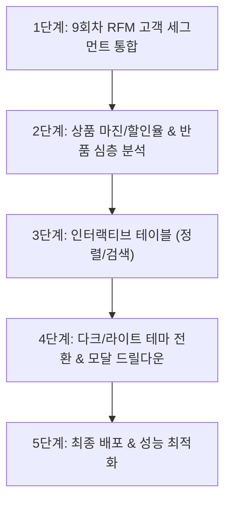

# 📋 장마트 경영 실적 대시보드 고도화 개발계획서

본 문서는 장마트 대시보드를 실제 실무 및 기업 경영진 보고용 수준으로 완성하기 위한 **단계별 고도화 실행 계획**과 각 단계에 최적화된 **추천 AI 모델 및 추론 수준(Reasoning Level)** 가이드입니다.

---

## 🧭 고도화 로드맵 요약

---

## 📌 단계별 세부 계획 및 모델·추론수준 매핑

### [1단계] 9회차 RFM 고객 세그먼트(VIP 분석) 연계
> **목표**: 9회차에서 도출한 고객 등급(VIP, 충성, 잠재, 일반, 이탈우려) 데이터를 대시보드에 결합하여 고객 가치 중심 모니터링 체계 구축

- **주요 작업**:
  1. `04_고객구매_데이터분석/고객별RFM_최종결과.csv` 데이터를 `data.js`에 세그먼트별 집계로 연동
  2. 고객 등급별 매출 기여도 파이/도넛 차트 추가
  3. 고객 등급별 평균 객단가(AOV) 및 평균 구매 빈도 비교 카드 구현
  4. 상단 필터바에 [고객 등급] 드롭다운 필터 추가
- **추천 모델 & 추론 수준**:
  - **추천 모델**: `Gemini Pro (또는 Flash High)`
  - **추론 수준**: **High (높음)**
  - **선정 이유**: 9회차 고객 RFM 결과 데이터와 10회차 장마트 거래 데이터 간의 조인(Join) 및 다차원 집계 로직 설계가 필요하므로 논리적 추론 능력이 뛰어난 모델 권장

---

### [2단계] 상품 프로모션(할인율) 및 반품률 심층 분석 뷰
> **목표**: 어떤 상품군이 할인을 많이 하고 있는지, 어느 카테고리의 반품률이 높은지 비즈니스 건전성 지표 시각화

- **주요 작업**:
  1. 카테고리별 평균 할인율(`할인금액 ÷ (상품단가 × 판매수량)`) 계산 및 할인 효율 산출
  2. 카테고리별 반품률 게이지 차트 또는 위험도 뱃지 추가 (주의/양호/위험)
  3. 요일별(평일 vs 주말) 및 결제수단(신용카드/간편결제/체크카드) 점유율 차트 구현
- **추천 모델 & 추론 수준**:
  - **추천 모델**: `Gemini Flash (또는 Pro)`
  - **추론 수준**: **High / Medium (중상)**
  - **선정 이유**: 수식 기반 파생 변수 계산 및 복합 차트(Chart.js 게이지/스택 바) 구성에 최적화된 균형적 성능 필요

---

### [3단계] 상세 데이터 그리드 기능 강화 (정렬 & 실시간 검색)
> **목표**: 월별/점포별 수치를 실무자가 즉시 엑셀처럼 정렬하고 원하는 키워드로 검색할 수 있는 인터랙티브 테이블 구축

- **주요 작업**:
  1. 테이블 헤더 클릭 시 오름차순/내림차순 동적 정렬 (`매출순`, `주문순`, `반품률순`)
  2. 테이블 상단에 실시간 텍스트 검색 인풋 필드 추가 (특정 월, 점포 즉시 필터)
  3. 테이블 행 클릭 시 해당 데이터에 맞는 미니 차트 하이라이트 연동
- **추천 모델 & 추론 수준**:
  - **추천 모델**: `Gemini Flash`
  - **추론 수준**: **Medium (중간)**
  - **선정 이유**: 정형화된 프론트엔드 DOM 조작 및 자바스크립트 정렬 알고리즘 작업으로 빠른 응답성과 코드 작성이 핵심

---

### [4단계] UI/UX 완성도 극대화: 다크/라이트 테마 & 모달 드릴다운
> **목표**: 보고서 발표 및 다양한 모니터 환경에 맞춘 원클릭 테마 전환과 지표별 상세 팝업 제공

- **주요 작업**:
  1. 상단 `[☀️ 라이트 모드 / 🌙 다크 모드]` 원클릭 토글 버튼 구현 (CSS 변수 테마 스위칭)
  2. 5대 KPI 카드 클릭 시 해당 지표의 12개월 히스토리와 점포별 기여도를 보여주는 **드릴다운 팝업 모달(Modal)** 추가
  3. 모바일 터치 환경에서의 스크롤 및 차트 툴팁 반응성 보강
- **추천 모델 & 추론 수준**:
  - **추천 모델**: `Gemini Flash`
  - **추론 수준**: **Low / Medium (보통)**
  - **선정 이유**: CSS 변수 치환, 모달 UI 이벤트 처리 등 명확한 프론트엔드 컴포넌트 추가 작업이므로 빠르고 군더더기 없는 모델 권장

---

### [5단계] 성능 최적화, 최종 검증 및 GitHub/Cloudflare Pages 동기화
> **목표**: 코드 무결성 검증, 데이터 경량화 및 프로덕션 웹 호스팅 배포 완료

- **주요 작업**:
  1. `dashboard/` 폴더 내 미사용 코드 제거 및 번들 경량화 확인
  2. 로컬 브라우저 크로스 체킹 (크롬, 엣지, 모바일 뷰)
  3. GitHub 원격 저장소(`main` 브랜치) 커밋 및 푸시
  4. Cloudflare Pages 배포 반영 및 최종 URL 동작 확인
- **추천 모델 & 추론 수준**:
  - **추천 모델**: `Gemini Flash`
  - **추론 수준**: **Low (낮음)**
  - **선정 이유**: 단순 Git 명령어 실행, 파일 복사 및 배포 상태 확인 등 실행 중심 작업

---

## 📊 추천 모델 및 추론 수준 한눈에 보기

| 단계 | 개발 영역 | 추천 AI 모델 | 추천 추론 수준 | 기대 작업 시간 |
| :---: | :--- | :---: | :---: | :---: |
| **1단계** | 9회차 RFM 고객 세그먼트 연계 | **Gemini Pro** | **High (Thinking)** | 약 10~15분 |
| **2단계** | 프로모션(할인) & 반품률 심층 지표 | **Gemini Flash** | **High** | 약 10분 |
| **3단계** | 인터랙티브 테이블 (정렬 & 검색) | **Gemini Flash** | **Medium** | 약 8분 |
| **4단계** | 다크/라이트 테마 전환 & 모달 팝업 | **Gemini Flash** | **Low ~ Medium** | 약 8분 |
| **5단계** | 코드 정리 & GitHub/웹 최종 배포 | **Gemini Flash** | **Low** | 약 5분 |

---

## 💡 시작 제안

다음 개발을 바로 진행하시려면, 고객의 구매 가치와 VIP 혜택을 분석할 수 있는 **[1단계: RFM 고객 세그먼트 연계]**부터 착수하는 것을 권장합니다. 준비되시면 말씀해 주세요!
